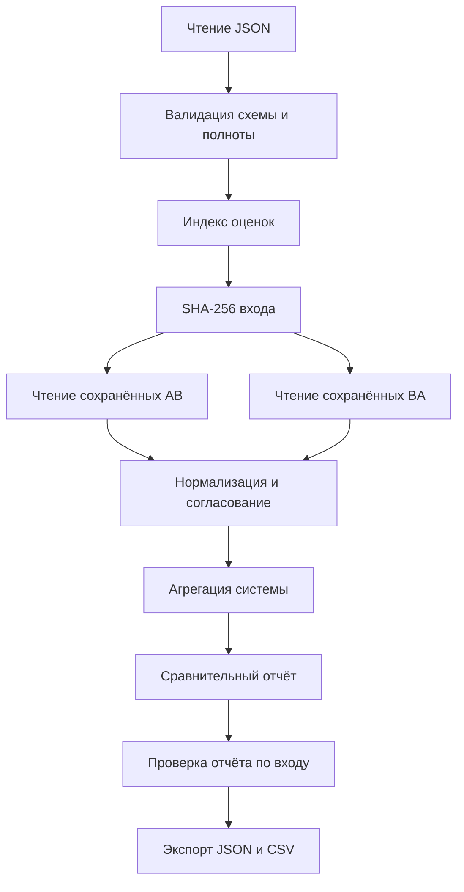

# vkr_2027_mipt_pipeline_jllm

Минимальный исполняемый **Dagster-граф сравнения сохранённых попарных оценок**
для ВКР о геопоиске и навигации. Базовый ассистент сравнивается с тремя
внешними системами по решённости, полноте и геоточности, в двух порядках AB/BA.

**Это offline/replay-версия, а не сервис LLM-судейства.** Она не собирает ответы,
не вызывает модели, не выполняет поиск и фактчекинг. В репозитории нет ключей,
реального корпуса, запросов, ответов, объяснений судьи и исторических результатов.
Демонстрация использует только искусственно заданные вердикты и ничего
не говорит о качестве конкретных моделей. Установка зависимостей требует сети;
сам расчёт — нет.

## Быстрый запуск

Python 3.10 или новее. Команды выполняются из корня этого репозитория:

```bash
python -m venv .venv
source .venv/bin/activate
python -m pip install -e '.[ui]'
export DAGSTER_HOME="$PWD/.dagster"
mkdir -p "$DAGSTER_HOME"
cp dagster.yaml "$DAGSTER_HOME/dagster.yaml"
python examples/make_demo.py
dagster job execute -m sbs_comparison.definitions -j compare_saved_judgments -c demo_run.yaml
```

Телеметрия Dagster отключается приведённой конфигурацией. Отчёты каждого запуска
создаются в отдельном каталоге `artifacts/results/<run_id>/`:
- `report.json` — канонические исходы, знаменатели, метрики и SHA-256 входа;
- `outcomes.csv` — одна строка на пару, с исходами трёх критериев и общим итогом.

CSV экранирует идентификаторы, похожие на формулы электронных таблиц; исходные
идентификаторы сохраняются в JSON. SHA-256 фиксирует содержимое входа, но не
подтверждает его подлинность или качество оценок.

### Граф в интерфейсе Dagster

После настройки окружения выше:

```bash
dagster dev -m sbs_comparison.definitions -h 127.0.0.1 -p 3000
```

Открыть http://127.0.0.1:3000 → Jobs → `compare_saved_judgments` → Graph.
Для запуска в Launchpad вставить содержимое `demo_run.yaml`.
Не открывайте интерфейс с реальными данными в публичную сеть.

## Что выполняет граф



Средняя часть повторяется для каждой системы и каждого критерия. Для трёх систем
это **37 настоящих операций Dagster**: 4 подготовительных + 18 чтений оценок
+ 9 согласований + 3 агрегации + 3 итоговых операции. Каждый узел исполняет свою
часть расчёта; это не один узел-обёртка. Используются последовательный in-process
executor, нулевые повторы и хранение промежуточных результатов в памяти.
Dagster сохраняет служебный журнал, но наш код не пишет входные оценки в логи.

Это упрощение исследовательского стенда: сетевые узлы судьи заменены чтением
готовых оценок; убраны управление бюджетом, возобновление и журналы API-попыток.
Сохранены правила AB/BA и строгой агрегации, но не вся инфраструктура исходного
исполнителя. Порядок независимых ветвей не фиксирован; параллельного исполнения нет.

## Формат входа

Генератор `examples/make_demo.py` создаёт полный валидный пример: 30 пар и 180 оценок.
Одна пара задаётся сочетанием `case_id` и `service`. У каждой пары должны быть
ровно шесть записей: три критерия × два порядка. Разное число пар у разных систем
допускается; каждая настроенная система должна иметь хотя бы одну пару.

Структура JSON (фрагмент; здесь показана только одна из шести оценок):

```json
{
  "schema_version": 1,
  "synthetic": true,
  "pairs": [{"case_id": "example_01", "service": "rival_1"}],
  "judgments": [{
    "case_id": "example_01", "service": "rival_1",
    "criterion": "solved", "order": "ab", "status": "ok", "verdict": "left"
  }]
}
```

- `criterion`: `solved`, `completeness`, `geo`.
- `order`: `ab` — базовый ассистент слева; `ba` — внешняя система слева.
- `status`: `ok`, `insufficient`, `not_applicable`, `invalid`, `not_run`.
- `verdict`: для `ok` только `left`, `right`, `tie`; иначе строго `null`.
- `synthetic`: `true` для искусственного примера, `false` для внешних реальных оценок.

Дубликаты, неизвестные поля и неполные наборы отвергаются. Пропущенное оценивание
нужно явно представить как `not_run`, а не молча удалять. Тексты запросов/ответов
не нужны. Идентификаторы могут быть чувствительными: обезличивайте их заранее.
Не добавляйте свои входы, отчёты, окружение или каталог Dagster в Git.

По умолчанию системы называются `rival_1`, `rival_2`, `rival_3`. Их список задаётся
константой `SERVICES` в `sbs_comparison/definitions.py`; фабрика `build_job`
поддерживает любое непустое число уникальных имён вида `rival_1`.

## Правила сравнения

1. `left`/`right` переводятся в `baseline`/`rival` с учётом порядка AB/BA.
2. Приоритет технических состояний: `not_run`, затем `invalid`.
3. Два `not_applicable` дают неприменимость; только один — `applicability_conflict`.
4. Любой `insufficient` даёт недостаточность оснований, **не ничью**.
5. Совпавшие нормализованные вердикты принимаются; несовпавшие дают `conflict`.

Общий итог пары вычисляется только при разрешённости всех применимых критериев.
При наличии неопределённости сохраняется первое состояние по приоритету:
`not_run` → `invalid` → `applicability_conflict` → `insufficient` → `conflict`.
Все исходы отдельных критериев при этом остаются в отчёте. Если все критерии
неприменимы, общий итог тоже `not_applicable`. Иначе используется сумма:
победа базового ассистента +1, внешней системы −1, ничья 0. Знак суммы определяет
победителя, нулевая сумма — ничью. Веса критериев равны.

В отчёте отдельно приведены:
- `total` — все пары системы;
- `applicable` — все, кроме согласованно неприменимых;
- `valid` — только победы и ничьи;
- покрытие по всем парам и по применимым;
- доли побед и ничьих **среди valid**, а не среди всех пар;
- счётчики каждого неразрешённого состояния.

`applicable` — технический знаменатель: конфликты применимости из него не
исключаются. При нулевом знаменателе метрика равна `null`. Неразрешённые случаи
не считаются проигрышами. Системы не ранжируются автоматически: состав их
доступных пар может различаться. Bootstrap, доверительные интервалы и проверки
гипотез не входят в этот минимальный граф.

## Проверки и структура

```bash
python -m unittest discover -s tests -v
```

Тесты проверяют перестановку сторон, комбинации состояний, строгий общий итог,
знаменатели, невалидные входы, топологию и реальный запуск всех 37 операций.
Интеграционные прогоны запрещают сетевые подключения и DNS, проверяют повторяемость
отчёта и отсутствие публикации при ошибке входа.

- `sbs_comparison/core.py` — чистые правила и валидация.
- `sbs_comparison/definitions.py` — граф Dagster и экспорт.
- `examples/make_demo.py` — только синтетические данные.
- `tests/test_comparison.py` — стандартный unittest, без дополнительных тестовых зависимостей.

Геоточность здесь — название входного критерия, не доказательство внешней
фактической проверки. Этот код воспроизводит обработку оценок, но без закрытого
корпуса и исходных вердиктов не воспроизводит численные результаты ВКР.
